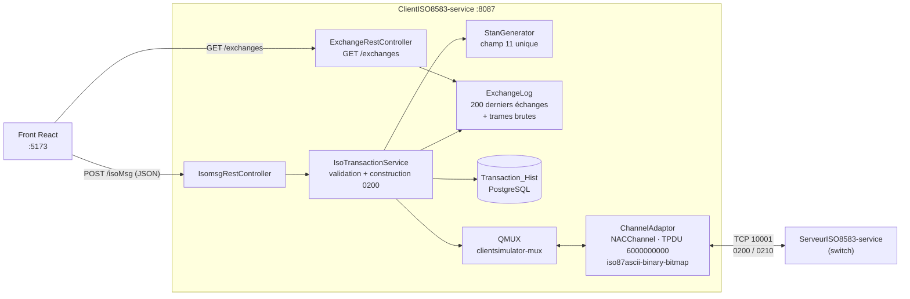
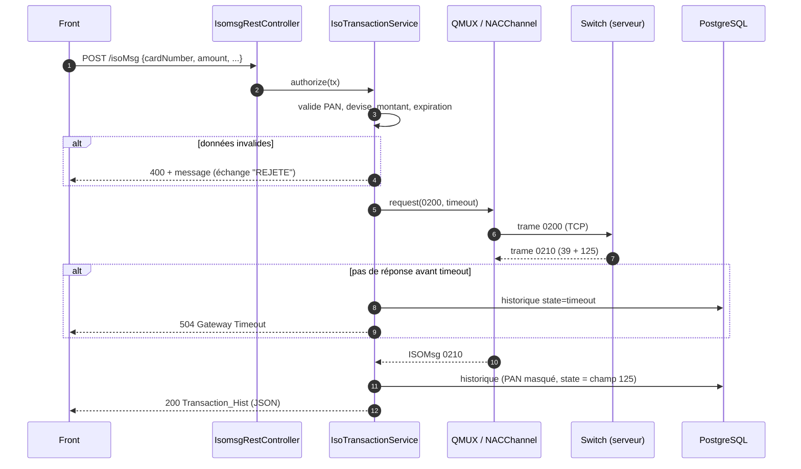

# ClientISO8583-service

Service **client / acquéreur** du simulateur ISO 8583. Il reçoit une transaction en JSON (REST),
la convertit en message ISO 8583 **0200**, l'envoie au switch par TCP (jPOS `QMUX` + `NACChannel`),
attend la réponse **0210**, puis enregistre le résultat dans l'historique.

- Spring Boot 2.7 · Java 17 · jPOS 2.1.7 · PostgreSQL (JPA)
- Port HTTP : **8087**
- Connexion ISO sortante : `127.0.0.1:10001` (voir `deploy/20_client.xml`)

## Architecture



## Déroulement d'une transaction



## Message 0200 construit

| Champ | Contenu | Source |
|---|---|---|
| MTI | `0200` | fixe |
| 2 | PAN (12 à 19 chiffres) | `cardNumber` |
| 3 | `000000` (achat) | fixe |
| 4 | Montant en centimes, 12 chiffres (`100.00` → `000000010000`) | `amount` |
| 7 | Date/heure de transmission `MMDDhhmmss` (UTC) | horloge |
| 11 | STAN unique sur 6 chiffres | `StanGenerator` |
| 12 / 13 | Heure `hhmmss` / date `MMDD` locales | `date_transaction` (`HH/mm/ss/MM/dd`) ou horloge |
| 14 | Expiration `AAMM` | `expireDate` (`yyyy-MM`) |
| 49 | Devise ISO 4217 numérique (`504`, `978`, `840`) | `code_Currency` |
| 120 | Routage (`8001` = server_1) | fixe |

Format de la trame sur le réseau (`NACChannel`) :

```
┌──────────┬──────────────────┬──────┬──────────────────────┬─────────────────────┐
│ Longueur │ En-tête TPDU     │ MTI  │ Bitmap (8 ou 16 oct.)│ Champs (ordre       │
│ 2 octets │ 60 00 00 00 00   │ ASCII│ binaire              │ croissant, ASCII)   │
└──────────┴──────────────────┴──────┴──────────────────────┴─────────────────────┘
```

## API REST

| Méthode | Route | Description |
|---|---|---|
| POST | `/isoMsg` | Envoie une transaction. Réponses : `200` (historique), `400` (données invalides), `502` (erreur d'envoi), `504` (timeout) |
| GET | `/exchanges?sinceId=N` | Journal en mémoire des échanges (champs + trames hex, PAN masqué) |
| DELETE | `/exchanges` | Vide le journal |
| GET | `/TransactionHist` | Historique des transactions |
| GET | `/Trs/{card}/{date}` | Dernière transaction pour une carte et une date (`hhmmssMMDD`) |
| DELETE | `/History/{id}` | Supprime une ligne d'historique |
| DELETE | `/deleteHist/{state}` | Supprime les lignes ayant cet état exact |
| GET | `/currency` | Liste des devises |
| GET | `/echo`, `/echo-v2` | Tests de connectivité (0200 factice) |
| GET | `/swagger-ui.html` | Documentation OpenAPI |

Exemple :

```bash
curl -X POST localhost:8087/isoMsg -H "Content-Type: application/json" -d "{\"cardNumber\":\"4111111111111111\",\"expireDate\":\"2027-08\",\"amount\":100,\"code_Currency\":\"504\",\"point_de_service\":\"POS-01\"}"
```

```json
{"id":1,"cardNumber":"411111______1111","expireDate":"2708","amount":100.0,"code_Currency":"504",
 "date_transaction":"1433351115","point_de_service":"POS-01","state":"success"}
```

## Configuration (`src/main/resources/bootstrap.properties`)

| Propriété | Défaut | Rôle |
|---|---|---|
| `server.port` | `8087` | Port HTTP |
| `spring.datasource.*` | `jdbc:postgresql://localhost:5432/Iso_BASE` | Base de données |
| `iso.mux.timeout-ms` | `30000` | Attente maximale de la réponse 0210 |
| `iso.packager-config` | `cfg/packager/iso87ascii-binary-bitmap.xml` | Packager utilisé pour afficher les trames |
| `iso.channel-header` | `6000000000` | En-tête TPDU affiché dans les trames |

Hôte et port du switch : `deploy/20_client.xml`. Les fichiers `deploy/` et `cfg/` sont lus depuis le
répertoire courant : lancer le service **depuis ce dossier**.

## Lancer

```bash
./mvnw spring-boot:run
```

Sans PostgreSQL (base en mémoire H2) :

```bash
./mvnw spring-boot:run -Dspring-boot.run.arguments="--spring.datasource.url=jdbc:h2:mem:cli --spring.datasource.username=sa --spring.datasource.password= --spring.jpa.properties.hibernate.dialect=org.hibernate.dialect.H2Dialect --spring.cloud.config.enabled=false"
```

## Structure

```
src/main/java/com/example/js_to_isoservice/
├── JsToIsoServiceApplication.java   # démarrage Q2 + bean MUX
├── entities/                        # Isomsg (DTO/entité), Transaction_Hist, Currency
├── iso/
│   ├── StanGenerator.java           # STAN unique (champ 11)
│   ├── ExchangeLog.java             # journal des échanges + reconstruction des trames
│   ├── IsoExchange.java, WireDump.java
│   └── ClientISORequestListener.java
├── services/IsoTransactionService.java  # JSON -> 0200 -> 0210 -> historique
└── web/                             # contrôleurs REST
deploy/   10_qmux.xml, 20_client.xml # configuration jPOS Q2
cfg/packager/                        # définitions des packagers ISO
```

## Sécurité

- Le PAN est **masqué** (`411111______1111`) dans les logs, l'historique et le journal des échanges.
- Les identifiants PostgreSQL du fichier de propriétés sont des valeurs de développement local :
  à remplacer par des variables d'environnement hors poste de dev.
- Aucune authentification sur l'API et CORS ouvert (`*`) : réservé à un usage local / démo.
